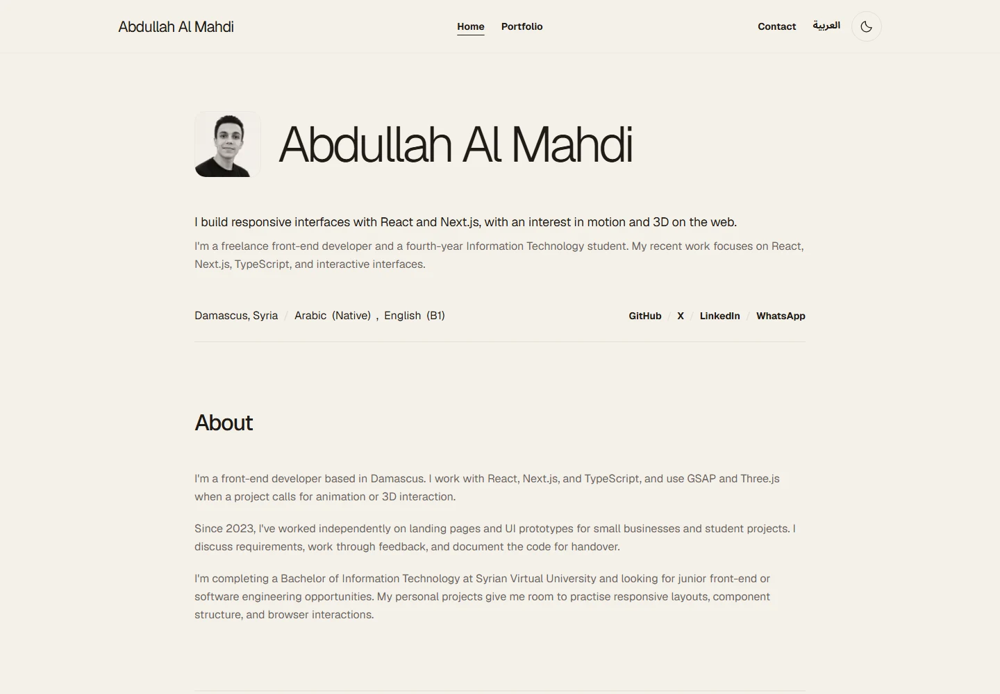

# Abdullah Al Mahdi — Portfolio Showcase

A bilingual Next.js portfolio presenting my front-end implementation work, skills, experience, and downloadable CV.

[Existing live portfolio](https://abdullah-almahdi-portfolio.netlify.app/) · [GitHub profile](https://github.com/AbdullahAlmahdi12)

**Status:** public source showcase with fresh Git history. The link above is the original deployment, not a deployment of this edition. This edition uses a redistributable Arabic font; the original portfolio and its deployment are unchanged.



## What I built

I rebuilt and personalised a supplied Framer portfolio as a standalone Next.js application, without a Framer embed or CMS. The site includes:

- English and Arabic routes, translated content, and right-to-left layouts.
- Light and dark themes, responsive navigation, and a fullscreen portrait viewer.
- A project index and four case studies with real screenshots and live-demo links.
- GSAP reveals, Lenis scrolling, and reduced-motion handling.
- Keyboard-accessible contact controls, email-copy error handling, and content that remains available without JavaScript.
- A text-selectable CV, with editable Markdown and a PDF generator.

The supplied template informed the layout; I do not claim ownership of its original design. Project descriptions distinguish my implementation work from reference designs and tutorial content.

## Stack

Next.js 16.3.8 / App Router · React 19.3 · TypeScript 5.9 · Tailwind CSS 4 · next-intl · GSAP · Lenis. Checks use ESLint, Node's test runner, and Playwright.

Three.js, Rive, and Framer Motion appear in descriptions of other projects; they are not dependencies of this portfolio.

## Selected work

| Project | Implementation focus | Live preview |
| --- | --- | --- |
| Apple iPhone 3D Showcase | React state, Three.js model controls, GSAP and video | [Open](https://abdullah-iphone-website.netlify.app/) |
| Brain Wave | Reusable landing-page sections, mobile navigation and parallax | [Open](https://abdullah-brain-wave.netlify.app/) |
| HooBank | Shared content data, responsive React sections and Tailwind styling | [Open](https://abdullah-hoobank.netlify.app/) |
| abd-studio | Next.js, typed content, gallery interactions and Rive fallbacks | [Open](https://abd-studio.netlify.app/) |

These are front-end learning projects, not operational banking, AI, commerce, or studio businesses. Their source repositories are currently private, so this edition omits inaccessible source buttons. Set a project's optional `repositoryLink` only after its actual public source URL exists.

The `abd-studio` case study visibly credits [Kargul Studio](https://kargul.studio/) for the original design and creative direction. It is a personal educational recreation, not client work or an affiliation.

## Run locally

Use Node.js 22.18+ and npm. The tests use Node's built-in TypeScript stripping; the lockfile fixes installed dependency versions.

```bash
npm ci
npm run dev -- --port 3011
```

For a production preview:

```bash
npm run build
npm start -- --port 3011
```

Open the address printed by Next.js. Port 3011 keeps this edition separate from an original portfolio running on port 3000.

No API keys or backend credentials are required. The optional `NEXT_PUBLIC_SITE_URL` controls canonical and sitemap URLs; it defaults to the existing portfolio address. Set it to the real deployment origin before deploying this edition. See [.env.example](.env.example); never put secrets in `NEXT_PUBLIC_*` variables. The existing `@swc/core` 1.16.0 override is retained for Windows compiler compatibility.

## Architecture and editing

| Location | Purpose |
| --- | --- |
| `src/content/site.json` | Canonical profile, projects, skills, work and education |
| `src/content/locales/ar.json` | Arabic copy and image descriptions |
| `src/messages/` | Translated navigation, contact and interface labels |
| `src/content/types.ts` | Content contracts shared by rendering and tests |
| `src/app/[locale]/` | Localized home, project index and detail routes |
| `src/components/` | Cards, case studies, navigation and interactive controls |
| `src/i18n/` | Locale routing and metadata helpers |
| `public/images/projects/` | Desktop and mobile screenshots of the existing demos |
| `docs/resume/` | Editable CV and PDF generation instructions |

English routes are `/`, `/portfolio`, and `/portfolio/<slug>`; Arabic uses the `/ar` prefix. Add matching Arabic copy and image descriptions when changing a project. Both locales have canonical/language alternates and sitemap entries. Content records stay separate from components, while interactive controls use client components where needed.

## Checks

```bash
npm run check
npx playwright install chromium
npm run test:browser
```

`check` runs lint, typecheck, content tests, and a production build. Browser tests start the production build on their configured port automatically. On Linux, use `npx playwright install --with-deps chromium` if browser system dependencies are missing.

The browser suite covers project navigation, 404 responses, contact/clipboard behavior, reduced motion, no-JavaScript content, source availability in both languages, and responsive widths from 320px to 1440px. A GitHub Actions workflow is included; a workflow file alone is not evidence that remote CI has passed. See [verification notes](docs/verification.md).

## What differs from the original

- Independent Git history, without old branches, tags, or deleted files from the private repository.
- No private handoff material, resume backups, capture scripts, or historical migration utility.
- Only active portraits, project screenshots, and fonts; unused template JPEGs and unused fonts are excluded.
- Private project-source actions replaced with an English/Arabic availability note; live and original-design links remain.
- Independent browser-server setup and repeatable checks.

## Fonts and attribution

The original portfolio uses **Thmanyah / ثمانية with permission**. That permission has not been confirmed to cover public redistribution, so **Thmanyah's `.otf` files are not included in this repository or its Git history**. They are excluded from Git and are not required to build or run this edition.

This public edition instead bundles **Noto Sans Arabic**, loaded locally through `next/font/local`. Arabic text, RTL layouts, and language controls work without private font files, external font requests, or a font-service account. Noto Sans Arabic and Geist are distributed with their SIL Open Font License notices.

[Third-party notices](THIRD_PARTY_NOTICES.md) and the [asset inventory](docs/assets.md) explain design, screenshot, and font attribution. Public visibility does not grant a blanket license to template design, screenshots, portraits, or brand artwork.
